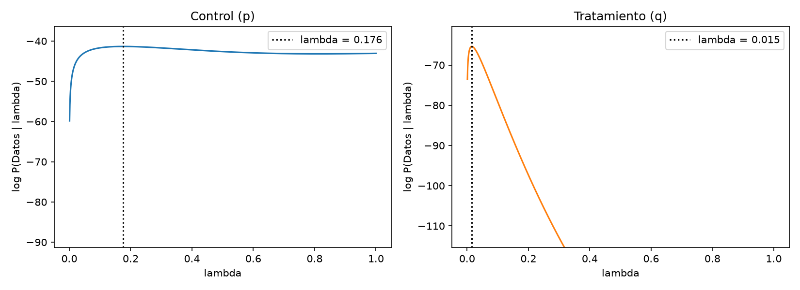
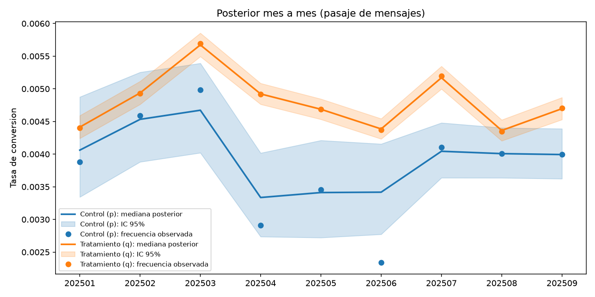
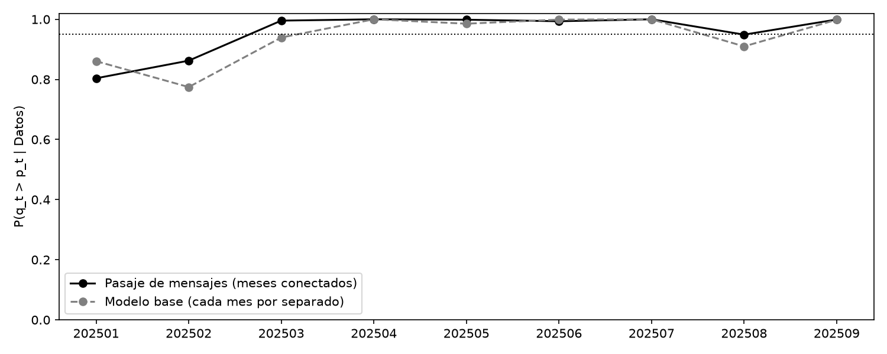
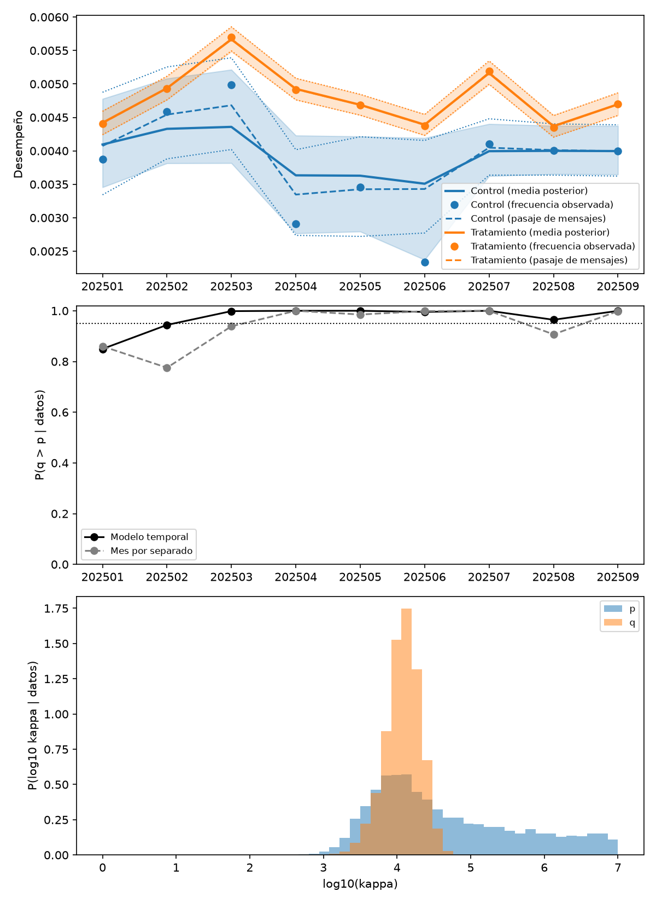
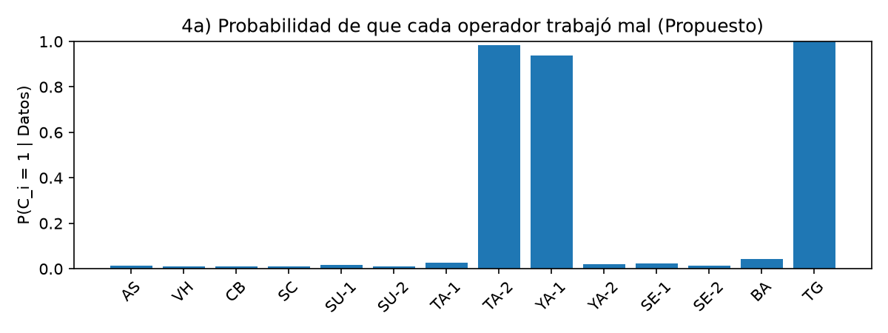
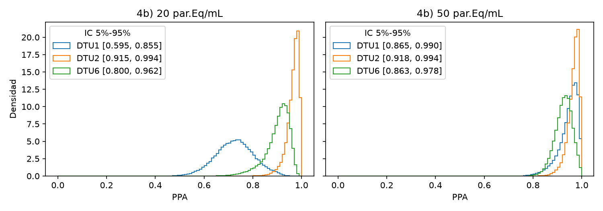

# Práctica 2.2 — Inferencia aproximada

## 1. Significancia estadística de los experimentos causales

Código: [`01-pasaje_mensajes.py`](01-pasaje_mensajes.py) (se ejecuta desde esta carpeta).

**Variables:**

- $t = 1, \dots, T$: el mes, con $T = 9$ meses (202501 a 202509).
- $N_t$: cantidad de usuarios de un grupo en el mes $t$.
- $n_t$: cuántos de esos usuarios convirtieron (`online_schedules`).
- $p_t$: tasa de conversión del grupo **control** en el mes $t$.
- $q_t$: tasa de conversión del grupo **tratamiento** en el mes $t$.

Cada grupo es una "cadena" de meses: $p_1, \dots, p_T$ para control y $q_1, \dots, q_T$ para
tratamiento. Abajo se escribe todo para $p_t$; para $q_t$ es igual.

### 1.1 Pasaje de mensajes

Cada mensaje es una distribución Beta, que se guarda como su par de conteos $(a, b)$. Con eso:

- multiplicar dos mensajes es sumar sus conteos;
- descontar un mensaje es multiplicar sus conteos por $\lambda$.

$\lambda \in (0, 1]$ es el **descuento**: cuánto de lo que se sabe de un mes pasa al mes
vecino. Si $\lambda = 1$, todos los meses son iguales; si $\lambda$ es chico, cada mes es casi
independiente.

Los mensajes que se usan son:

- `likelihood(p_t)` $= (n_t,\ N_t - n_t)$: lo que dice el dato del mes $t$ (éxitos y fracasos).
- `forwardPrior(p_t)`: lo que llega desde los meses anteriores a $t$.
- `backwardPrior(p_t)`: lo que llega desde los meses posteriores a $t$.
- `withinPrior(p_t)`: todo lo que se sabe del mes $t$ sin contar su propio dato.
- `posterior(p_t)`: todo lo que se sabe del mes $t$.

Se hace una pasada hacia adelante (forward) y otra hacia atrás (backward):

- `forwardPrior(p_1) = (1, 20)` y `forwardPrior(p_{t+1}) = λ · (forwardPrior(p_t) + likelihood(p_t))`.
- `backwardPrior(p_T) = (0, 0)` y `backwardPrior(p_{t-1}) = λ · (backwardPrior(p_t) + likelihood(p_t))`.
- `withinPrior(p_t) = forwardPrior(p_t) + backwardPrior(p_t)`.
- `posterior(p_t) = withinPrior(p_t) + likelihood(p_t)`.

### 1.2 Elección de λ

Para elegir $\lambda$ se mira qué tan bien predice cada mes a partir de los demás. La
predicción del mes $t$ es una BetaBinomial: la probabilidad de ver $n_t$ éxitos en $N_t$
intentos cuando la tasa no se conoce y tiene distribución Beta(`withinPrior(p_t)`):

$$P(n_t \mid N_t, \lambda) = \text{BetaBinomial}(n_t \mid N_t, \text{withinPrior}(p_t))$$

Es leave-one-out porque `withinPrior` no contiene el dato del mes $t$. Se suman los
logaritmos de todos los meses (log-evidencia) y se toma el $\lambda$ que da el máximo. Se
prueban 1000 valores entre 0.001 y 1, por separado para cada cadena.

| Cadena | λ elegido | log-evidencia |
|---|---|---|
| Control ($p_t$) | 0.176 | −41.34 |
| Tratamiento ($q_t$) | 0.015 | −65.38 |

El tratamiento elige un λ mucho menor. Con ~600 mil usuarios por mes, cada mes tiene mucha
información y la tasa cambia de un mes a otro, así que la evidencia castiga traer mucha
información de los meses vecinos.

### 1.3 Posteriors mes a mes

Mediana e intervalo del 95% de `posterior(p_t)` y `posterior(q_t)`, junto con la frecuencia
observada $n_t / N_t$.

### 1.4 $P(q_t > p_t \mid \text{Datos})$

Es la probabilidad de que en el mes $t$ el tratamiento tenga mayor tasa que el control. Se
estima sacando muestras de los dos posteriors y contando en qué proporción la de tratamiento
es mayor.

Se compara con el **modelo base** (figura 1 del enunciado), que analiza cada mes por separado:
prior Beta(1, 20) y posterior Beta(1 + $n_t$, 20 + $N_t - n_t$).

| Mes | Pasaje de mensajes | Cada mes por separado (modelo base) |
|---|---|---|
| 202501 | 0.804 | 0.861 |
| 202502 | 0.862 | 0.775 |
| 202503 | 0.996 | 0.939 |
| 202504 | 1.000 | 1.000 |
| 202505 | 0.999 | 0.985 |
| 202506 | 0.994 | 0.999 |
| 202507 | 1.000 | 1.000 |
| 202508 | 0.949 | 0.910 |
| 202509 | 0.999 | 0.999 |

El valor de enero con el modelo base (0.861) coincide con el de la figura 2 del enunciado
(0.8612). Conectar los meses sube sobre todo marzo (0.94 → 0.996) y agosto (0.91 → 0.95), que
analizados solos no llegaban a 0.95. Enero baja un poco porque el control de los meses vecinos
es más alto. Con estos datos, igualmente, varios meses (abril a julio, septiembre) ya eran
concluyentes analizados por separado.

### Opcional: modelo temporal en PyMC

Código: [`01-incrementalidad_kernel.py`](01-incrementalidad_kernel.py). Es el modelo de la
figura 3, con una cadena por grupo.

**Variables nuevas:**

- $\kappa$: qué tanto se parece un mes al anterior. Con $\kappa$ grande la tasa casi no cambia
  entre meses; con $\kappa$ chico puede cambiar mucho. Cada cadena tiene su propio $\kappa$
  ($\kappa_p$ para control y $\kappa_q$ para tratamiento). Cumple el mismo papel que $\lambda$,
  pero acá no se fija sino que se infiere.
- $p_0$: tasa del primer mes.

$$
\log_{10}\kappa \sim U[0, 7], \quad p_0 \sim \text{Beta}(1, 20), \quad
p_t \mid p_{t-1} \sim \text{Beta}(\kappa\, p_{t-1}, \kappa (1 - p_{t-1})), \quad
n_t \sim \text{Binomial}(N_t, p_t)
$$

Se muestrea con 2000 muestras y 4 cadenas de muestreo (no confundir con las cadenas de meses),
con `target_accept = 0.99`.

**Diagnósticos:**

- **Divergencias:** avisos del muestreador de que no pudo recorrer bien una zona del
  posterior. Tienen que ser 0.
- **$\hat r$:** compara las 4 cadenas de muestreo. Si convergieron dan lo mismo y
  $\hat r \approx 1$; tiene que ser $\le 1.01$.
- **ESS:** cantidad de muestras efectivas (independientes) que equivalen a las obtenidas.

Resultado:

- Hubo 40 divergencias, todas en una misma cadena de muestreo.
- $\hat r$ máximo 1.010 y ESS mínimo 361.
- El control tiene un $\kappa$ poco identificado ($\log_{10}\kappa_p = 4.7 \pm 1.0$, con una cola
  larga hasta 7), y ahí es donde aparecen las divergencias.
- El tratamiento lo identifica bien ($\log_{10}\kappa_q = 4.08 \pm 0.24$).

| Mes | media $p_t$ PyMC | media $p_t$ mensajes | media $q_t$ PyMC | media $q_t$ mensajes | $P(q_t>p_t)$ PyMC | $P(q_t>p_t)$ mensajes |
|---|---|---|---|---|---|---|
| 202501 | 0.00409 | 0.00407 | 0.00442 | 0.00441 | 0.850 | 0.804 |
| 202502 | 0.00433 | 0.00454 | 0.00494 | 0.00494 | 0.944 | 0.862 |
| 202503 | 0.00436 | 0.00468 | 0.00567 | 0.00567 | 0.999 | 0.996 |
| 202504 | 0.00363 | 0.00335 | 0.00493 | 0.00492 | 1.000 | 1.000 |
| 202505 | 0.00363 | 0.00343 | 0.00469 | 0.00469 | 1.000 | 0.999 |
| 202506 | 0.00351 | 0.00343 | 0.00439 | 0.00439 | 0.996 | 0.994 |
| 202507 | 0.00400 | 0.00405 | 0.00516 | 0.00517 | 1.000 | 1.000 |
| 202508 | 0.00400 | 0.00401 | 0.00437 | 0.00436 | 0.965 | 0.949 |
| 202509 | 0.00400 | 0.00400 | 0.00470 | 0.00470 | 1.000 | 1.000 |

Para el tratamiento los dos métodos dan prácticamente el mismo posterior. Para el control, el
modelo temporal suaviza más que el pasaje de mensajes (la media posterior varía menos entre
meses), porque integra sobre la incertidumbre de $\kappa$ en vez de fijar un único λ. Por eso
en febrero y agosto $P(q_t > p_t)$ es algo mayor con PyMC. Las conclusiones son las mismas:
salvo enero, el tratamiento supera al control con probabilidad mayor a 0.94 en todos los meses.

## 2. Experimento con datos escasos y corrompidos

Código: [`02-comparacion_modelos.py`](02-comparacion_modelos.py). Salida impresa: [`2-salida.txt`](2-salida.txt).

**Datos y variables:**

- $i = 1, \dots, 14$: el operador (cada laboratorio que hizo las pruebas).
- $k \in \{\text{DTU1}, \text{DTU2}, \text{DTU6}\}$: la cepa del parásito.
- Concentración: 20 o 50 par.Eq/mL (cantidad de parásito en la muestra).
- $c$: el **contexto**, una combinación de concentración y cepa (por ejemplo 20-DTU1). Hay 6
  contextos.
- $n_{c,i}$: cuántas de las 3 muestras del contexto $c$ dieron positivo para el operador $i$
  (de 0 a 3).
- $p_c$: el **desempeño** del test en el contexto $c$, es decir, la probabilidad de que dé
  positivo en una muestra que tiene el parásito (en los gráficos figura como PPA). $p_{20,k}$ y
  $p_{50,k}$ son los desempeños de la cepa $k$ a 20 y a 50 par.Eq/mL.
- $C_i$: vale 1 si el operador $i$ trabajó mal y 0 si trabajó bien. No se observa.
- $q$: probabilidad de que un operador trabaje mal. No tiene relación con el $q_t$ de la
  sección 1.
- $r$ (o $r_i$): factor entre 0 y 1 que multiplica el desempeño cuando el operador trabaja mal.

Los modelos del enunciado son:

- **Base:** todos los operadores trabajan bien, $n_{c,i} \sim \text{Binomial}(3, p_c)$.
- **Operadores:** cada operador trabaja mal con probabilidad $q$, y si trabaja mal su
  desempeño pasa a ser $p_c \cdot r$, con un único $r$ para todos.

### 2.1 Modelo propuesto

$p^*_c$ es el desempeño efectivo que usa el modelo en cada contexto.

$$
\begin{aligned}
p_c &\sim \text{Beta}(2,2) \qquad c \in \{20\text{-DTU1}, \dots, 50\text{-DTU6}\} \\
p^*_{20,k} &= p_{20,k}, \qquad p^*_{50,k} = \max(p_{20,k},\, p_{50,k}) \qquad k \in \{\text{DTU1, DTU2, DTU6}\} \\
q &\sim \text{Beta}(1, 9) \\
r_i &\sim \text{Beta}(1, 1) \qquad i = 1,\dots,14 \\
C_i &\sim \text{Bernoulli}(q) \\
n_{c,i} &\sim \begin{cases} \text{Binomial}(3, p^*_c) & C_i = 0 \\ \text{Binomial}(3, p^*_c\, r_i) & C_i = 1 \end{cases}
\end{aligned}
$$

$C_i$ no se observa, así que se suma sobre sus dos valores (ecuación 8), igual que en el
modelo con operadores pero con $r_i$ en lugar de $r$:

$$P(n_i) = (1 - q)\, P(n_i \mid C_i = 0) + q\, P(n_i \mid C_i = 1)$$

donde $n_i$ son los 6 resultados del operador $i$.

**Supuestos causales:**

- **(a) Cada operador falla en su propia medida ($r_i$).** El error de un operador depende de
  qué hizo mal: aplicar mal un paso del protocolo, usar un reactivo vencido, cargar mal la
  planilla. No hay razón para que todos los que trabajan mal reduzcan la detección en la misma
  proporción. Con un único $r$, un operador que falla mucho y otro que falla poco obligan a un
  valor intermedio que no explica bien a ninguno.
- **(b) Más parásito no puede bajar la detección.** Una muestra con 50 par.Eq/mL contiene más
  parásito que una con 20 par.Eq/mL de la misma cepa, así que el test tiene al menos la misma
  probabilidad de detectarlo: $p_{50,k} \geq p_{20,k}$. Se impone tomando como desempeño
  efectivo en concentración alta $\max(p_{20,k}, p_{50,k})$.

### 2.2 Comparación de modelos

Se usa una variable $M$ (el **selector**) que indica qué modelo generó los datos: Base,
Operadores o Propuesto. $P(M)$ es su prior y $P(M \mid \text{Datos})$ su posterior, que se
estima como la proporción de muestras en las que el muestreador "visitó" cada modelo.

Por Bayes, $P(M \mid \text{Datos}) \propto P(\text{Datos} \mid M)\, P(M)$, así que la
log-evidencia de cada modelo es, salvo una constante:

$$\log P(\text{Datos} \mid M) = \log P(M \mid \text{Datos}) - \log P(M)$$

Primero se corre con prior uniforme. Si un modelo casi no se visita, su evidencia queda mal
estimada, así que se repite con un prior que lo favorece y después se descuenta ese prior con la
fórmula de arriba. Se usan 20000 muestras por cadena y 4 cadenas.

| Modelo | log-evidencia relativa | $P(M \mid \text{Datos})$ |
|---|---|---|
| Base | −10.59 | 0.0000 |
| Operadores | −4.01 | 0.0178 |
| **Propuesto** | **0.00** | **0.9821** |

La log-evidencia es relativa al mejor modelo (el mejor queda en 0). $P(M \mid \text{Datos})$ es
la que se obtiene con prior uniforme entre los tres.

La diferencia Operadores − Base (≈ 6.6) coincide con la que reporta el enunciado (≈ 6.5).
El modelo propuesto tiene una log-evidencia ≈ 4 mayor que el de operadores (≈ 55 veces más probable).

**Convergencia y visitas del selector** (divergencias y $\hat r$ como en la sección 1):

| Corrida | Prior de M | Visitas (Base / Operadores / Propuesto) | divergencias | $\hat r$ máx |
|---|---|---|---|---|
| Intento 1 | uniforme | 1 / 1229 / 78770 | 0 | 1.0025 |
| Intento 2 | (0.9934, 0.0065, 0.0001) | 8187 / 38627 / 33186 | 0 | 1.0168 |
| Modelo propuesto solo (punto 3) | — | — | 0 | 1.0005 |

En el intento 1 la Base casi no se visita, por eso se repite con un prior que la favorece. El
resultado es estable: con 5000 muestras por cadena se había obtenido −10.22 / −3.62 / 0.

### 2.3 Análisis con el modelo de mayor evidencia (Propuesto)

**a) Probabilidad de que cada operador haya trabajado mal**, $P(C_i = 1 \mid \text{Datos})$.
TA-2, YA-1 y TG son casi con certeza operadores que trabajaron mal; el resto tiene
probabilidad menor a 0.05.

**b) Posterior marginal del desempeño $p^*_c$ en cada contexto** (IC 5%–95% en la leyenda).

**c) $P(p_i > p_j \mid \text{Datos})$ en concentración baja.** Acá $p_i$ y $p_j$ son los
desempeños a 20 par.Eq/mL de dos cepas: la de la fila y la de la columna de la tabla. Se calcula
con las muestras conjuntas del posterior: en cada muestra se compara $p_i$ con $p_j$.

| $P(\text{fila} > \text{columna})$ | DTU1 | DTU2 | DTU6 |
|---|---|---|---|
| DTU1 | — | 0.001 | 0.032 |
| DTU2 | 0.999 | — | 0.912 |
| DTU6 | 0.968 | 0.088 | — |

En concentración baja el test detecta peor la cepa DTU1 que DTU2 (0.999) y que DTU6 (0.968).
Entre DTU2 y DTU6 la diferencia es menos segura (0.912).

